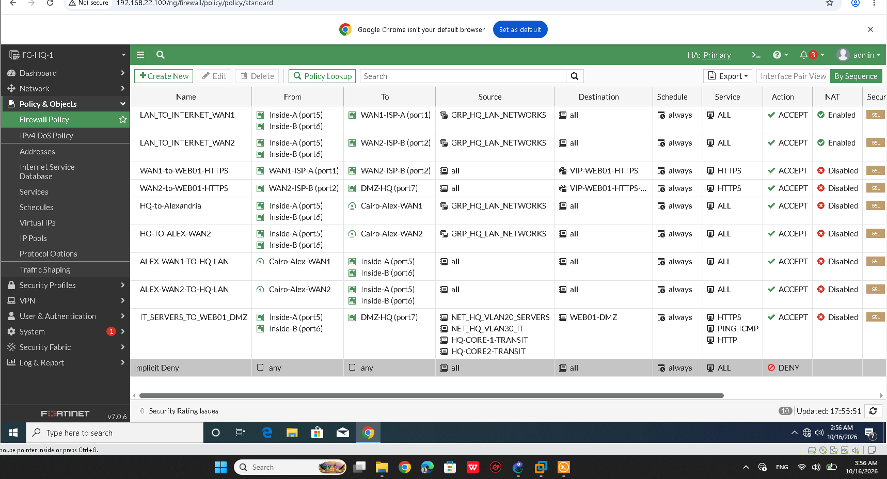
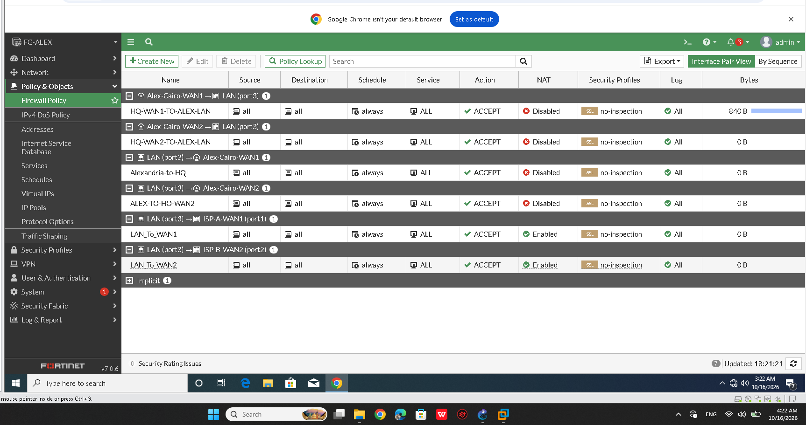
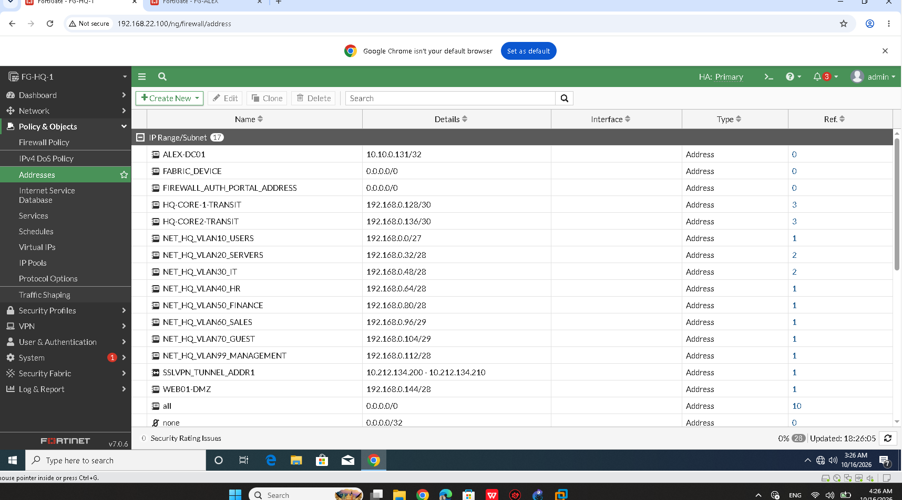
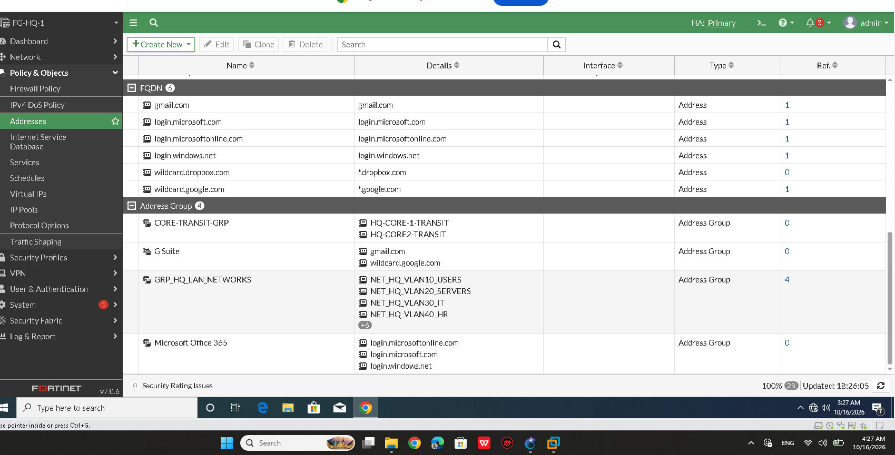
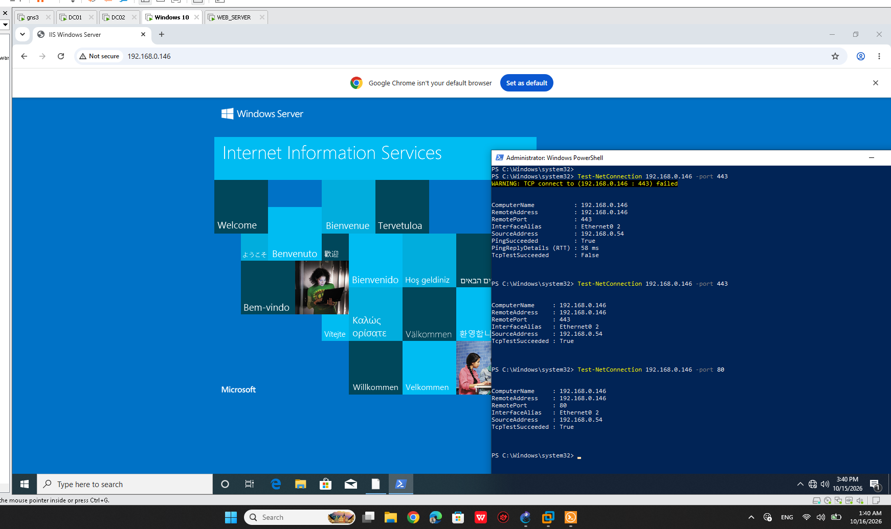

# FortiGate Firewall Policies and Connectivity Verification

## 1. Overview

This document records the FortiGate firewall policy inventory and the connectivity tests performed in the Enterprise Multi-Site Network & Security Infrastructure Lab.

It covers Cairo HQ (`FG-HQ-1`), Alexandria (`FG-ALEX-01`), address objects and groups, Internet access policies, inter-site traffic, DMZ access, and the external HTTPS publishing issue.

The document distinguishes between:

- **Configured:** The policy or object is visible in the captured configuration.
- **Test Passed:** The specific connectivity test succeeded.
- **Test Failed or Inconsistent:** The test failed or produced mixed results.
- **Not Independently Verified:** The available evidence does not prove the individual policy's behavior.

A successful connectivity test does not automatically prove which firewall policy allowed the traffic. Policy-level confirmation requires matching traffic logs, policy IDs, or counters to the test.

## 2. Cairo HQ — FG-HQ-1 Policy Inventory

The captured firewall policy screen shows the following policies:

| Policy Name | Source / Incoming Interface | Destination / Outgoing Interface | Action | NAT |
|---|---|---|---|---|
| `LAN_TO_INTERNET_WAN1` | `Inside-A (port5)`, `Inside-B (port6)` | `WAN1-ISP-A (port1)` | ACCEPT | Enabled |
| `LAN_TO_INTERNET_WAN2` | `Inside-A (port5)`, `Inside-B (port6)` | `WAN2-ISP-B (port2)` | ACCEPT | Enabled |
| `WAN1-to-WEB01-HTTPS` | `WAN1-ISP-A (port1)` | Displayed as `WAN2-ISP-B (port2)` | ACCEPT | Disabled |
| `WAN2-to-WEB01-HTTPS` | `WAN2-ISP-B (port2)` | `DMZ-HQ (port7)` | ACCEPT | Disabled |
| `HQ-to-Alexandria` | `Inside-A (port5)`, `Inside-B (port6)` | `Cairo-Alex-WAN1` | ACCEPT | Disabled |
| `HO-TO-ALEX-WAN2` | `Inside-A (port5)`, `Inside-B (port6)` | `Cairo-Alex-WAN2` | ACCEPT | Disabled |
| `ALEX-WAN1-TO-HQ-LAN` | `Cairo-Alex-WAN1` | `Inside-A (port5)`, `Inside-B (port6)` | ACCEPT | Disabled |
| `ALEX-WAN2-TO-HQ-LAN` | `Cairo-Alex-WAN2` | `Inside-A (port5)`, `Inside-B (port6)` | ACCEPT | Disabled |
| `IT_SERVERS_TO_WEB01_DMZ` | Inside interfaces | `DMZ-HQ (port7)` | ACCEPT | Disabled |

The `IT_SERVERS_TO_WEB01_DMZ` policy lists these source objects:

- `NET_HQ_VLAN20_SERVERS`
- `NET_HQ_VLAN30_IT`
- `HQ-CORE-1-TRANSIT`
- `HQ-CORE-2-TRANSIT`

Its destination is `WEB01-DMZ`, and its displayed services are HTTPS, PING-ICMP, and HTTP.

The policy list also shows an implicit deny rule.

**Configuration observation:** The displayed outgoing interface for `WAN1-to-WEB01-HTTPS` appears as `WAN2-ISP-B (port2)`. This is recorded as shown in the screenshot. Do not assume that it is correct or change it without checking the live policy configuration.

**Evidence — Cairo HQ firewall policies**



## 3. Alexandria — FG-ALEX-01 Policy Inventory

The captured Alexandria firewall policy screen shows:

| Policy Name | Direction / Interface Pair | Action | NAT |
|---|---|---|---|
| `HQ-WAN1-TO-ALEX-LAN` | `Alex-Cairo-WAN1` to `LAN (port3)` | ACCEPT | Disabled |
| `HQ-WAN2-TO-ALEX-LAN` | `Alex-Cairo-WAN2` to `LAN (port3)` | ACCEPT | Disabled |
| `Alexandria-to-HQ` | `LAN (port3)` to `Alex-Cairo-WAN1` | ACCEPT | Disabled |
| `ALEX-TO-HO-WAN2` | `LAN (port3)` to `Alex-Cairo-WAN2` | ACCEPT | Disabled |
| `LAN_To_WAN1` | `LAN (port3)` to `ISP-A-WAN1 (port1)` | ACCEPT | Enabled |
| `LAN_To_WAN2` | `LAN (port3)` to `ISP-B-WAN2 (port2)` | ACCEPT | Enabled |

The screenshot showed `840 B` for `HQ-WAN1-TO-ALEX-LAN` and `0 B` for `HQ-WAN2-TO-ALEX-LAN` at the time of capture.

These counters are observations from that capture only. They do not independently prove that one policy is fully functional or that the other policy is broken.

**Evidence — Alexandria firewall policies**



## 4. Address Objects and Address Groups

### 4.1 Address Objects

FortiGate address objects represent individual hosts, subnets, or other supported address definitions. They allow firewall policies to reference named network resources instead of repeatedly entering IP addresses.

The HQ firewall policy inventory references the following source objects in the `IT_SERVERS_TO_WEB01_DMZ` policy:

- `NET_HQ_VLAN20_SERVERS`
- `NET_HQ_VLAN30_IT`
- `HQ-CORE-1-TRANSIT`
- `HQ-CORE-2-TRANSIT`

The policy destination is `WEB01-DMZ`.

Address-object names and their actual configured IP addresses or subnets must be checked against the FortiGate configuration. The names alone are not proof of the underlying address values.

**Evidence — HQ Address Objects**



### 4.2 Address Groups

FortiGate address groups combine multiple address objects into a logical group. They simplify policy administration when multiple hosts or networks require the same access rules.

Address groups should be documented with their configured member objects. Do not infer group membership from the group name or from a policy that uses a similarly named object.

**Evidence — HQ Address Groups**



### 4.3 Relationship to Firewall Policies

The relationship between address objects, address groups, and firewall policies is important:

1. Address objects define individual network resources.
2. Address groups combine multiple objects into a logical group.
3. Firewall policies use source and destination objects or groups to determine which traffic can match a rule.
4. Services, interfaces, schedules, action, and NAT settings also affect the resulting traffic behavior.

The presence of an address object or group does not independently prove that the associated policy permits the intended traffic.

**Evidence scope:** The screenshots document the Address Objects and Address Groups screens. Firewall policy behavior is evaluated separately using the recorded connectivity tests and firewall logs.

## 5. Internal LAN-to-DMZ Connectivity

The DMZ web server is recorded as:

| Field | Value |
|---|---|
| Server name | `WEB01-DMZ` |
| IP address | `192.168.0.146` |
| DMZ subnet | `192.168.0.144/28` |
| FortiGate DMZ interface | `DMZ-HQ (port7)` |
| Internal policy | `IT_SERVERS_TO_WEB01_DMZ` |

The policy is configured to allow HTTP, HTTPS, and ICMP from the listed internal source objects to the DMZ server.

### 5.1 HTTP Test

The Windows Server test output showed:

```text
Test-NetConnection 192.168.0.146 -Port 80

RemoteAddress    : 192.168.0.146
RemotePort       : 80
SourceAddress    : 192.168.0.54
TcpTestSucceeded : True
```

**Result: PASS — TCP connectivity to port 80 succeeded from `192.168.0.54`.**

The browser also displayed the IIS Windows Server welcome page at `192.168.0.146`.

**Evidence — DMZ HTTP Access**



### 5.2 HTTPS Test

The captured PowerShell session showed two tests to TCP port 443:

- First attempt: `TcpTestSucceeded : False`
- Second attempt: `TcpTestSucceeded : True`

Both tests used source address `192.168.0.54` and destination `192.168.0.146`.

**Result: MIXED — TCP connectivity to port 443 failed in the first attempt and succeeded in the second attempt.**

The available evidence does not establish why the results differed. It also does not prove that an external HTTPS request through either WAN VIP succeeds.

### 5.3 ICMP Test

Previously recorded FortiGate evidence showed five successful ICMP replies to `192.168.0.146`, with 0% packet loss.

**Result: PASS — ICMP reachability from the FortiGate to the DMZ server was demonstrated.**

The HTTP, HTTPS, and ICMP tests establish results for their specific sources, destinations, and protocols. They do not independently prove that every source object in `IT_SERVERS_TO_WEB01_DMZ` was tested or that this policy was the exact policy matched by each test.

## 6. Internet Access Policies

The captured policies show NAT enabled for:

- HQ: `LAN_TO_INTERNET_WAN1`
- HQ: `LAN_TO_INTERNET_WAN2`
- Alexandria: `LAN_To_WAN1`
- Alexandria: `LAN_To_WAN2`

The lab also has separate verification evidence for Dual-WAN default-route failover from WAN1 to WAN2 and recovery to WAN1.

**Result: PASS — Dual-WAN default-route failover and recovery were demonstrated in the recorded tests.**

This routing result does not independently prove that every Internet access policy has been tested separately or that every application works through both WANs.

See [Dual-WAN Failover Verification](../Verification/dual-wan-verification.md).

## 7. Inter-Site Traffic and VPN Policies

The captured HQ policy inventory contains:

- `HQ-to-Alexandria`
- `HO-TO-ALEX-WAN2`
- `ALEX-WAN1-TO-HQ-LAN`
- `ALEX-WAN2-TO-HQ-LAN`

The Alexandria policy inventory contains:

- `HQ-WAN1-TO-ALEX-LAN`
- `HQ-WAN2-TO-ALEX-LAN`
- `Alexandria-to-HQ`
- `ALEX-TO-HO-WAN2`

These policies are configured to permit traffic between the displayed tunnel interfaces and internal interfaces.

The project also contains recorded VPN tunnel and routing evidence demonstrating the intended path change to WAN2 and recovery to WAN1.

**Result: PASS — VPN path failover and recovery were demonstrated in the recorded VPN tests.**

This does not mean every inter-site firewall policy has been independently tested against every source, destination, and service.

See [IPsec VPN Verification](../Verification/ipsec-vpn.md).

## 8. External HTTPS Publishing to the DMZ

The external HTTPS VIPs are recorded as follows:

| VIP | Interface | External IP | Mapped IP | Port Mapping |
|---|---|---|---|---|
| `VIP-WEB01-HTTPS` | `WAN1-ISP-A (port1)` | `198.51.100.2` | `192.168.0.146` | TCP/443 → 443 |
| `VIP-WEB01-HTTPS-WAN2` | `WAN2-ISP-B (port2)` | `203.0.113.2` | `192.168.0.146` | TCP/443 → 443 |

These are the recorded lab values. The VIP configuration and matching firewall policies must be interpreted together; the policy screenshot alone does not prove that the entire publishing path is correct.

### 8.1 WAN1 External Test

An external TCP test from `INET-EDGE` to `198.51.100.2:443` opened a TCP connection. The recorded logs showed traffic associated with `WAN1-to-WEB01-HTTPS`.

**Result: PARTIAL — The external TCP connection opened, but the evidence does not establish a successful HTTPS application response.**

### 8.2 WAN2 External Test

The external TCP test from `INET-EDGE` (`203.0.113.250`) to `203.0.113.2:443` timed out.

The recorded FortiGate debug flow showed:

1. The incoming packet arrived on `port2`.
2. Destination NAT translated the destination to `192.168.0.146:443`.
3. The packet was dropped after `reverse path check fail`.

The recorded routing evidence showed WAN1 as the preferred default route with distance 10 and WAN2 as the backup route with distance 20.

**Result: FAIL — External HTTPS publishing through the WAN2 VIP remains unresolved.**

The reverse-path check failure is the observed drop reason in the captured debug flow. The underlying cause has not been confirmed. No configuration change should be described as a verified fix until the relevant tests pass again.

This specific issue does not invalidate the recorded successful Dual-WAN route failover/recovery, VPN path failover/recovery, or internal LAN-to-DMZ connectivity tests.

## 9. Connectivity Test Summary

| Test | Source | Destination | Result |
|---|---|---|---|
| HTTP TCP connection | `192.168.0.54` | `192.168.0.146:80` | PASS |
| HTTPS TCP connection — first attempt | `192.168.0.54` | `192.168.0.146:443` | FAIL |
| HTTPS TCP connection — second attempt | `192.168.0.54` | `192.168.0.146:443` | PASS |
| ICMP reachability | FortiGate | `192.168.0.146` | PASS |
| HQ core connectivity | `HQ-CORE-1` | `10.10.1.5` | PASS — 5/5 replies in the captured test |
| PC1 to gateway | PC1 | `192.168.0.1` | PASS — 5/5 replies in the captured test |
| PC1 to `10.10.1.1` | PC1 | `10.10.1.1` | MIXED — replies and timeouts shown |
| PC2 to `10.10.1.5` | PC2 | `10.10.1.5` | PASS — 5/5 replies in the captured test |
| External TCP via WAN1 | `INET-EDGE` | `198.51.100.2:443` | PARTIAL — TCP connection opened |
| External TCP via WAN2 | `INET-EDGE` | `203.0.113.2:443` | FAIL — timeout; reverse-path check failure observed |
| Dual-WAN route failover/recovery | FortiGate lab | WAN1/WAN2 paths | PASS |
| VPN path failover/recovery | HQ/Alexandria VPN | WAN1/WAN2 paths | PASS |

The connectivity tests demonstrate the observed results for their specific test conditions. They do not, by themselves, identify the exact firewall policy matched by every packet.

## 10. Remaining Issue

The main outstanding issue covered by this document is:

**External HTTPS publishing through WAN2 to `WEB01-DMZ` (`192.168.0.146:443`).**

The captured debug flow identified a reverse-path check failure after destination NAT. The root cause remains unconfirmed and must be established from the live routing, policy, and traffic evidence before making a corrective change.

The recorded results do not classify the following demonstrated functionality as generally incomplete:

- Dual-WAN route failover and recovery.
- VPN path failover and recovery.
- Internal LAN-to-DMZ connectivity.

## 11. Conclusion

The captured firewall policy screens document the configured policies on `FG-HQ-1` and `FG-ALEX-01`. The accompanying connectivity evidence demonstrates successful HTTP access to the DMZ server, successful ICMP reachability from the FortiGate, recorded inter-site connectivity tests, and the demonstrated Dual-WAN and VPN path failover/recovery behavior.

Address objects and address groups are part of the policy design and are documented with their respective screenshots. Their names alone do not prove that their values, group memberships, or policy references are correct.

Some tests produced mixed results, and the external WAN2 HTTPS publishing issue remains unresolved.

Policy existence, packet counters, configuration evidence, and successful connectivity tests are documented separately so that configuration evidence is not mistaken for independent proof that every firewall policy has passed testing.
