# Network Topology and Architecture

## 1. Project Overview

This project simulates an enterprise network connecting Cairo Headquarters (HQ) and Alexandria Branch using GNS3, Cisco IOS devices, FortiGate firewalls, Windows Server, and VMware Workstation.

The architecture includes:

- Redundant core switching at Cairo HQ.
- FortiGate Active-Passive High Availability.
- Dual ISP connectivity with automatic WAN failover and recovery.
- VLAN segmentation, 802.1Q trunking, and HSRP.
- Multi-area OSPF routing.
- Two site-to-site IPsec VPN tunnels with WAN path failover and recovery.
- A DMZ hosting the web server.
- Windows Active Directory, DNS, and DHCP services.
- A legacy RIP routing domain with ALEX-ASBR as the intended redistribution point.
- VMware VMnet8 for Internet/NAT connectivity.

## 2. Cairo HQ

### 2.1 Core Switching

The Cairo HQ core layer consists of `HQ-CORE-1` and `HQ-CORE-2`.

The design uses VLANs, 802.1Q trunking, EtherChannel, spanning tree, HSRP, Layer 3 SVIs, DHCP relay, and OSPF.

See [IP Addressing and VLANs](ip-addressing-vlans.md).

### 2.2 Core-to-FortiGate Transit

| VLAN | Name | Network | Core Address | FortiGate Address |
|---:|---|---|---|---|
| 901 | FW-TRANSIT-A | `192.168.0.128/30` | CORE-1: `192.168.0.129` | `192.168.0.130` |
| 902 | FW-TRANSIT-B | `192.168.0.136/30` | CORE-2: `192.168.0.137` | `192.168.0.138` |

The recorded CORE-1 configuration confirms VLAN 901 and a default route through `192.168.0.130`.

### 2.3 FortiGate High Availability

The Cairo firewall cluster consists of:

- `FG-HQ-1` — Primary
- `FG-HQ-2` — Secondary

The cluster uses Active-Passive HA.

| Function | Interface |
|---|---|
| WAN1 | `port1` |
| WAN2 | `port2` |
| HA heartbeat | `port3`, `port4` |
| Core connections | `port5`, `port6` |
| DMZ | `port7` |
| Management | `port8` |

Captured HA output showed healthy cluster status, synchronized configurations, and the expected Primary/Secondary roles. Separate screenshots document a role change and recovery.

These results document HA status and role-change behavior. They do not independently prove uninterrupted application traffic during an HA failover.

### 2.4 Dual ISP Connectivity

| Component | Address |
|---|---|
| FortiGate WAN1 | `198.51.100.2/29` |
| ISP-A gateway | `198.51.100.1` |
| FortiGate WAN2 | `203.0.113.2/29` |
| ISP-B gateway | `203.0.113.1` |
| INET node on ISP-A network | `198.51.100.250` |
| INET node on ISP-B network | `203.0.113.250` |

VMware VMnet8 provides the lab's external Internet/NAT connection.

The recorded tests demonstrated WAN1 as the preferred default route, failover to WAN2 when WAN1 became unavailable, and recovery to WAN1 after restoration.

**Result: PASS — Dual-WAN default-route failover and recovery were demonstrated.**

The failure-state monitor capture showed 54% packet loss on WAN1. The subsequent recovery evidence showed both monitors alive with 0% packet loss. These are observations from different captured states.

#### Dual-WAN Evidence

**Before failover — HA status**

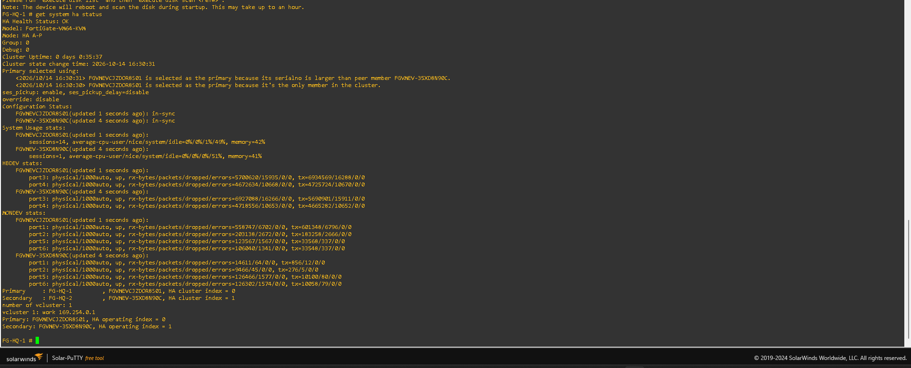

**Before failover — routing table**

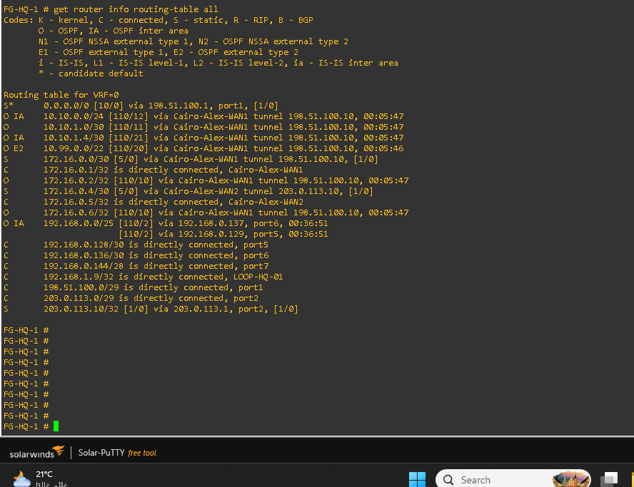

**Before failover — both WAN monitors**

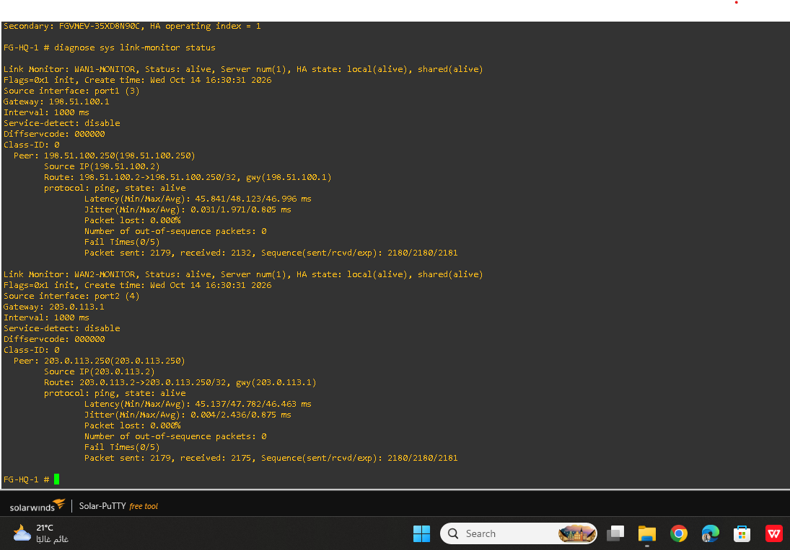

**During failover — WAN1 down**

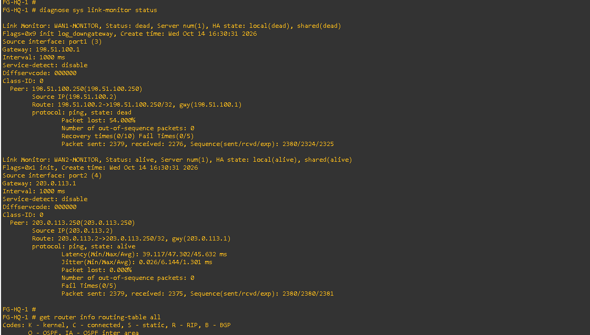

**Failover — default route switched to WAN2**

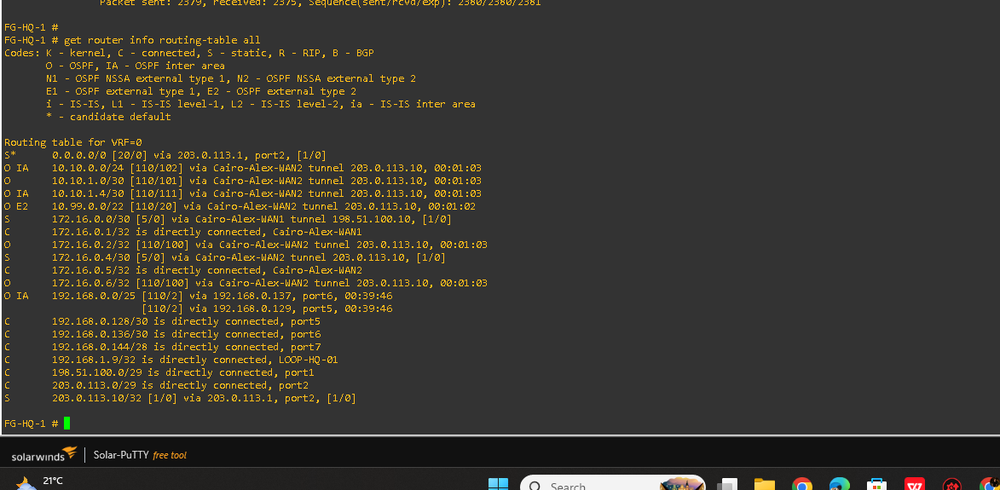

**WAN2 monitor target reachable**

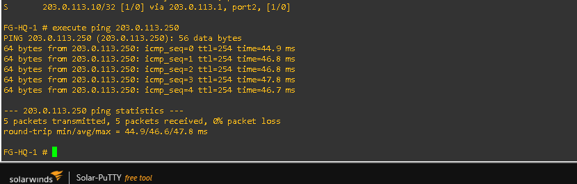

**Recovery — preferred route returned to WAN1**

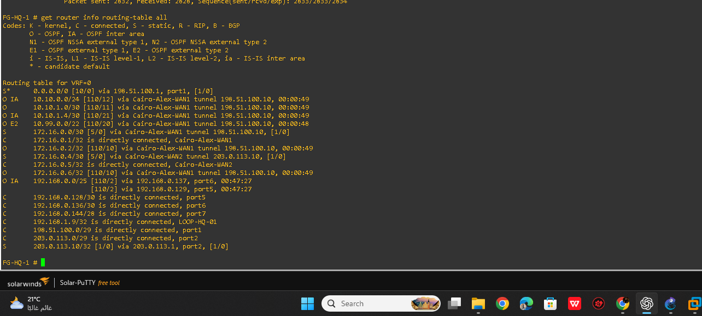

**WAN1 monitor target reachable after recovery**

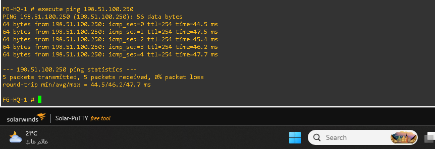

See [Dual-WAN Failover Verification](../Verification/dual-wan-verification.md).

### 2.5 DMZ

The recorded DMZ subnet is `192.168.0.144/28`.

| Component | Address |
|---|---|
| FortiGate DMZ interface | `192.168.0.145` |
| WEB01 | `192.168.0.146` |

Internal LAN-to-DMZ access to WEB01 is completed and documented.

The external VIP configurations map TCP port 443 to `192.168.0.146:443` through WAN1 and WAN2. External HTTPS publishing through WAN2 remains unresolved: the recorded debug flow showed destination NAT followed by a reverse-path check failure and packet drop.

**Result:** LAN-to-DMZ access is completed. WAN2-to-DMZ HTTPS remains the outstanding publishing issue.

See [FortiGate Firewall Policies](fortigate-firewall-policies.md) for the recorded policy and troubleshooting details.

## 3. Alexandria Branch

### 3.1 ALEX-CORE

| Interface | Recorded Address |
|---|---|
| Ethernet0/0 | `10.10.1.1/30` |
| Ethernet0/1 | `10.10.1.5/30` |
| Loopback0 | `10.10.0.177/32` |
| VLAN 10 SVI | `10.10.0.2/25` |
| VLAN 20 SVI | `10.10.0.130/27` |
| VLAN 30 SVI | `10.10.0.193/28` |
| VLAN 99 SVI | `10.10.0.162/28` |

The branch VLANs are USERS, SERVERS, SALES, and MANAGEMENT.

The supplied interface output showed these SVIs down/down at the time of capture. This historical result should not be treated as their current state without a newer check.

### 3.2 OSPF

The supplied ALEX-CORE configuration records:

- OSPF process: `1`
- Router ID: `5.5.5.5`
- Area 0 network: `10.10.1.0/30`
- Area 2 network: `10.10.1.4/30`
- Area 2 summary: `10.10.0.0/24`
- Default route via `10.10.1.2`

The recorded configuration and design handoff contain an addressing discrepancy for the `10.10.1.0/30` link. The peer addressing should be reconciled against the current running configuration before making changes.

### 3.3 Legacy Routing

The legacy routing design uses RIPv2 and OSPF, with ALEX-ASBR as the intended redistribution point.

The planned address space includes `10.99.0.0/22`, point-to-point networks `10.99.0.0/30` and `10.99.0.4/30`, and legacy LANs `10.99.1.0/27` and `10.99.2.0/27`.

HQ-CORE-1 displayed `10.99.0.0/22` as an OSPF External Type 2 route. The exact source protocol and redistribution statements require configuration-level confirmation.

## 4. Cairo–Alexandria IPsec VPN

The design includes two route-based IPsec tunnels.

| Tunnel | Network | Cairo Address | Alexandria Address | Intended OSPF Cost |
|---|---|---|---|---:|
| Tunnel A — Primary | `172.16.0.0/30` | `172.16.0.1` | `172.16.0.2` | 10 |
| Tunnel B — Backup | `172.16.0.4/30` | `172.16.0.5` | `172.16.0.6` | 100 |

The collected evidence documents active IPsec tunnel state, data counters, routing through the preferred WAN1 path, failover to WAN2, and recovery to WAN1.

**Result: PASS — VPN path failover to WAN2 and recovery to WAN1 were demonstrated by the recorded lab tests.**

### VPN Evidence

**Tunnel status before failover**

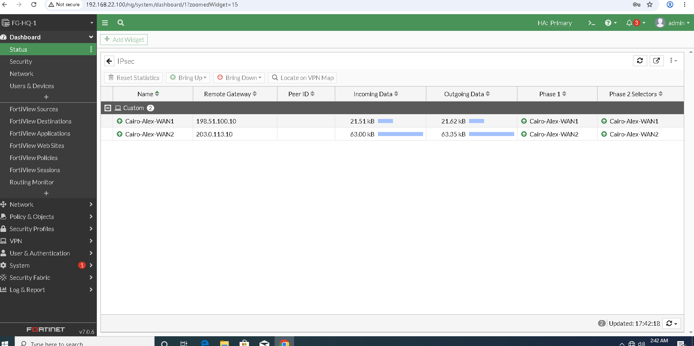

**Routing before failover**

**WAN1 as the primary route**

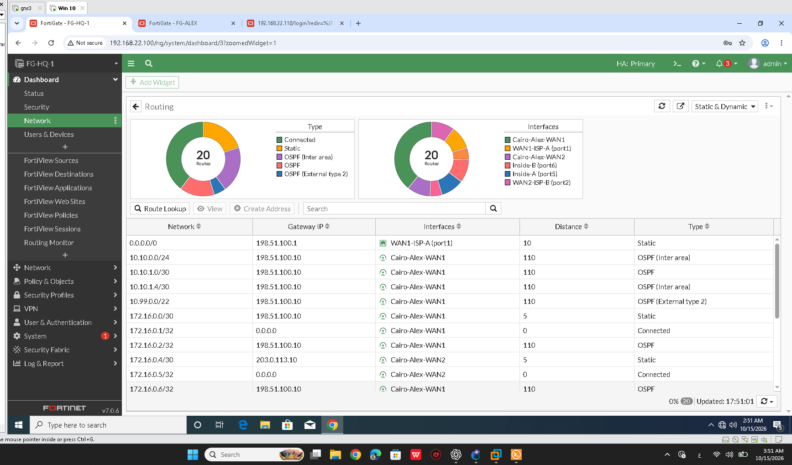

**WAN1 down and WAN2 up**

**VPN failover state**

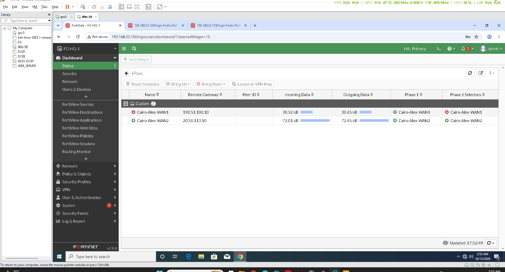

**Failover to WAN2**

**Recovery to WAN1**

The remote-access VPN pool `172.16.1.0/27` is reserved in the design and is separate from the site-to-site VPN verification described above.

See [IPsec VPN Verification](../Verification/ipsec-vpn.md).

## 5. Routing Architecture

The intended routing design includes:

- Cairo internal VLAN networks in OSPF Area 1.
- Cairo core-to-firewall transit in OSPF Area 0.
- Alexandria local VLAN networks in OSPF Area 2.
- Alexandria backbone connectivity in OSPF Area 0.
- Cairo summary `192.168.0.0/25`.
- Alexandria summary `10.10.0.0/24`.
- ALEX-ASBR as the RIP/OSPF redistribution point.
- Tunnel A as the preferred path and Tunnel B as the alternate path.

Collected routing outputs showed OSPF adjacencies, a static default route toward the FortiGate transit connection, and an OSPF External Type 2 route for `10.99.0.0/22` on HQ-CORE-1.

The recorded VPN tests also demonstrated route selection through the WAN1 and WAN2 paths in their respective test states.

See [Routing Verification](../Verification/routing.md).

## 6. Windows Server Services

| Server | Address | Gateway | Notes |
|---|---|---|---|
| DC01 | `192.168.0.36/28` | `192.168.0.33` | Domain: `test.local` |
| DC02 | `192.168.0.37/28` | `192.168.0.33` | DNS recorded as `192.168.0.36` |

The project includes Active Directory Domain Services, DNS, and DHCP. Service-specific status should be interpreted according to the relevant configuration and test evidence.

## 7. Management Network

The management network uses `192.168.22.0/24`.

Recorded management addresses include:

- `192.168.22.100`
- `192.168.22.110`
- `192.168.22.120`

Refer to the addressing documentation for the recorded device assignments.

## 8. Verification Summary

| Feature | Recorded Result |
|---|---|
| FortiGate HA health and synchronization | PASS — healthy and in-sync in captured output |
| HA role change and recovery | Observed and documented |
| Dual-WAN default-route failover | PASS |
| Dual-WAN recovery to WAN1 | PASS |
| Site-to-site IPsec tunnel operation | PASS — operational in captured states |
| VPN failover to WAN2 | PASS |
| VPN recovery to WAN1 | PASS |
| LAN-to-DMZ access | Completed and documented |
| OSPF adjacencies and recorded routes | Confirmed in captured outputs |
| External HTTPS from WAN2 to DMZ | Outstanding issue — reverse-path check failure observed |
| Exact RIP/OSPF redistribution source | Requires configuration-level confirmation |
| HA failover with uninterrupted application traffic | Not established by role-change evidence alone |

## 9. Remaining Validation

The main outstanding technical issue is external HTTPS publishing through the WAN2 DMZ VIP.

Additional configuration-level clarification may be needed for:

1. The recorded ALEX-CORE link-addressing discrepancy.
2. The exact RIP/OSPF redistribution statements.
3. The origin and purpose of the recorded `172.16.0.x/32` routes.
4. A controlled HA failover test with application traffic, if required by the project's acceptance criteria.

These items do not invalidate the recorded successful Dual-WAN route failover/recovery or VPN path failover/recovery tests.

## 10. Conclusion

The lab documents a multi-site enterprise network with redundant Cairo core switching, FortiGate Active-Passive HA, dual ISP paths, multi-area OSPF, two site-to-site IPsec tunnels, a segmented DMZ, and Windows Server services.

The recorded evidence demonstrates Dual-WAN route failover and recovery, VPN path failover and recovery, IPsec tunnel activity, OSPF routing activity, and internal LAN-to-DMZ access.

The outstanding external publishing issue is WAN2-to-DMZ HTTPS. It is not a general failure of the VPN, Dual-WAN routing, or internal DMZ access.
