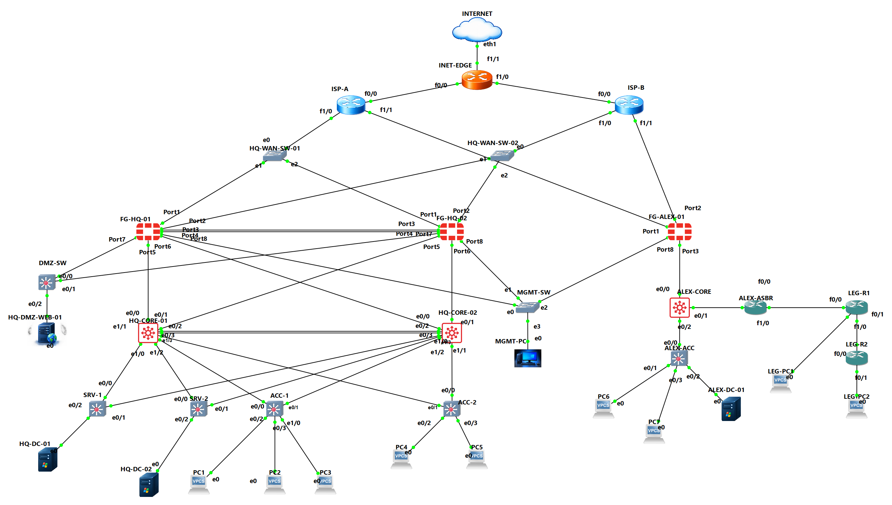
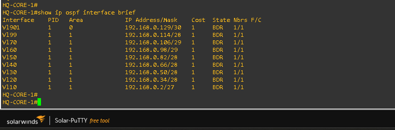
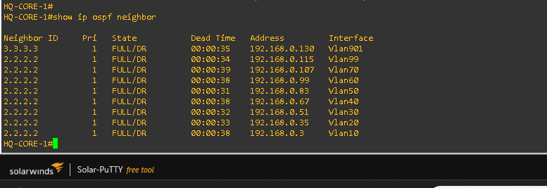
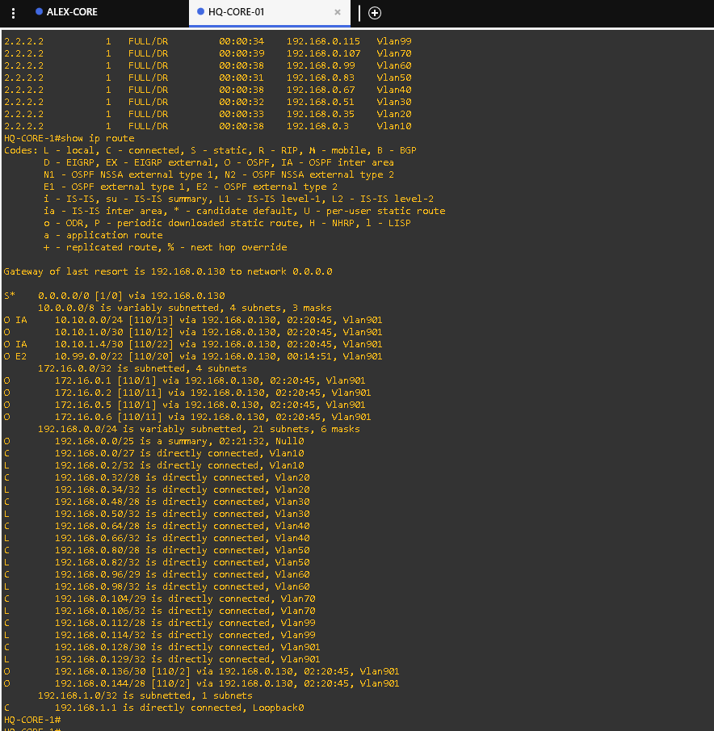

# Enterprise Multi-Site Network & Security Infrastructure Lab

A virtual enterprise networking and security lab built with **GNS3, Cisco IOS/IOU, FortiGate, Windows Server, and VMware Workstation**.

The project simulates an enterprise network connecting Cairo Headquarters (HQ) and Alexandria Branch. It demonstrates VLAN segmentation, Layer 2 and Layer 3 switching, dynamic routing, firewall integration, dual-WAN redundancy, site-to-site IPsec VPNs, high availability, and infrastructure services.

The repository documents the architecture, implementation, troubleshooting process, configuration inventory, and verification evidence collected from the lab.

## Network Topology



*Enterprise network topology connecting Cairo HQ and Alexandria Branch.*

## Project Highlights

- Multi-site enterprise network architecture.
- VLAN segmentation and inter-VLAN routing.
- OSPF dynamic routing and routing-table analysis.
- HSRP gateway redundancy and EtherChannel.
- FortiGate firewall integration and security policies.
- FortiGate Active-Passive High Availability (HA).
- Dual-WAN failover and recovery.
- Route-based site-to-site IPsec VPN tunnels.
- DMZ web server and HTTPS Virtual IP (VIP) configurations.
- Windows Server infrastructure integration.
- Troubleshooting using routing tables, packet captures, debug flow, and connectivity tests.

## Technologies

| Technology | Purpose |
|---|---|
| GNS3 | Network topology simulation |
| Cisco IOS / IOU | Switching and routing |
| VLANs / 802.1Q | Network segmentation |
| HSRP | Default-gateway redundancy |
| EtherChannel | Link aggregation |
| OSPF | Dynamic routing |
| FortiGate | Firewalling, routing, VIPs, and VPN |
| IPsec VPN | Site-to-site connectivity |
| Dual-WAN | Primary and backup Internet paths |
| Windows Server | Infrastructure services |
| VMware Workstation | Virtualization and lab connectivity |

## Network Architecture

### Cairo Headquarters

The HQ network includes:

- `HQ-CORE-01` and `HQ-CORE-02` as the core switching layer.
- `FG-HQ-01` and `FG-HQ-02` in an Active-Passive HA configuration.
- Department-based VLANs and Layer 3 interfaces.
- HSRP and EtherChannel.
- Two simulated ISP connections through WAN1 and WAN2.
- Internal server connectivity.
- A DMZ web server at `192.168.0.146`.
- HTTPS VIP configurations for both WAN interfaces.

### Alexandria Branch

The branch network includes:

- `FG-ALEX-01` as the branch firewall.
- `ALEX-CORE` as the branch core switch.
- Local VLANs and OSPF routing.
- Site-to-site IPsec connectivity to Cairo HQ.

### Inter-Site Connectivity

Two route-based IPsec tunnels connect Cairo HQ and Alexandria Branch. The lab includes evidence of tunnel activity, routing changes, WAN-path failover, and recovery.

The verification documents distinguish observed tunnel and routing behavior from confirmed end-to-end application connectivity.

## Verification Evidence

### 1. Dual-WAN Failover and Recovery

The lab demonstrates a change from WAN1 to WAN2 when the primary path fails, followed by recovery to WAN1 when the preferred path becomes available again.

**Failover to WAN2**


**WAN Monitoring During Failover**


**Recovery to WAN1**


The collected recovery evidence shows 0% packet loss on both WAN monitors at the time of capture. During the recorded WAN1 failure, the monitor showed 54% packet loss.

These results document the observed failover and recovery behavior; they do not imply zero interruption during the transition.

[Read the Dual-WAN Failover Verification](Verification/dual-wan-verification.md)

### 2. FortiGate High Availability

The recorded HA status showed:

- `FG-HQ-01` as Primary.
- `FG-HQ-02` as Secondary.
- Synchronization status reported as `in-sync`.
- HA health reported as `OK`.
- Recorded role-change and recovery evidence.

**HA Synchronization Status**


**Observed Role Change to FG-HQ-02**


**HA Recovery**


The screenshots document the observed HA state and role changes. They do not independently prove uninterrupted application traffic during failover.

[Read the FortiGate HA Verification](Verification/fortigate-ha-verification.md)

### 3. OSPF and Routing

Collected routing evidence includes OSPF interfaces, neighbor relationships, and the HQ core routing table.

**OSPF Interfaces**



**OSPF Neighbors**



**Routing Table**



The recorded outputs showed OSPF adjacencies in `FULL` state on the displayed links, routes to remote networks, and a default route on the HQ core pointing to `192.168.0.130`.

Routing-table evidence confirms the displayed routes at the time of capture; it does not, by itself, prove every end-to-end path or redundancy scenario.

[Read the Routing Verification](Verification/routing.md)

### 4. Site-to-Site IPsec VPN

The lab contains two configured route-based IPsec tunnels between Cairo HQ and Alexandria Branch. Verification evidence includes tunnel status, routing information, WAN1/WAN2 path changes, and recovery screenshots.

**VPN Tunnels Before Failover**


**VPN Routing with WAN1 Primary**


**WAN1 Down and WAN2 Up**


**VPN Failover to WAN2**


**VPN Recovery to WAN1**


The collected evidence documents tunnel and routing behavior during the recorded tests. Tunnel status and route changes alone do not prove uninterrupted application connectivity.

[Read the IPsec VPN Verification](Verification/ipsec-vpn.md)

### 5. DMZ and External HTTPS

The DMZ web server is configured at `192.168.0.146`, with HTTPS VIP configurations on both WAN interfaces.

The recorded troubleshooting results were:

| Test | Observed result |
|---|---|
| ICMP from `FG-HQ-01` to `192.168.0.146` | Passed: 5 packets received, 0% packet loss |
| TCP connection to `192.168.0.146:443` from the firewall | Connection established, then closed by the remote host |
| External TCP test to WAN1 VIP | TCP connection opened; WAN1 HTTPS policy traffic was observed |
| External TCP test to WAN2 VIP | Timed out |
| WAN2 debug flow | DNAT to `192.168.0.146:443`, followed by `reverse path check fail` and packet drop |

**Outstanding issue:** External HTTPS access through the WAN2 VIP has not been confirmed. The debug output identified a reverse-path check failure after DNAT, but the underlying cause has not been established.

A successful TCP connection does not prove that the HTTPS application returns a valid response. No configuration change should be described as a fix until the relevant tests pass again.

## Documentation

| Document | Description |
|---|---|
| [Network Topology and Architecture](Documentation/network-topology.md) | Network design, device roles, and site architecture |
| [IP Addressing and VLANs](Documentation/ip-addressing-vlans.md) | VLAN IDs, subnets, and gateway addressing |
| [FortiGate Firewall Policies](Documentation/fortigate-firewall-policies.md) | Firewall policies, DMZ VIPs, and observed connectivity |
| [Dual-WAN Failover Verification](Verification/dual-wan-verification.md) | WAN failover, monitoring, and recovery evidence |
| [FortiGate HA Verification](Verification/fortigate-ha-verification.md) | HA roles, synchronization, health, and role-change evidence |
| [Routing Verification](Verification/routing.md) | OSPF neighbors, routing tables, and recorded routing behavior |
| [IPsec VPN Verification](Verification/ipsec-vpn.md) | VPN status, routing, failover, and recovery evidence |
| [Configuration Inventory](configs/README.md) | Device configuration file inventory and publication guidance |

## Configuration Inventory

The `configs/` directory contains the following device configuration files:

### Core Switches

- `HQ-CORE-01-running-config.txt`
- `HQ-CORE-02-running-config.txt`
- `ALEX-CORE-running-config.txt`

### Access Switches

- `ACC-1-running-config.txt`
- `ACC-2-running-config.txt`
- `ALEX-ACC-running-config.txt`
- `SRV-1-running-config.txt`
- `SRV-2-running-config.txt`

`SRV-1` and `SRV-2` are switches connected to the server infrastructure, not server machines.

### Routing Devices

- `ALEX-ASBR-running-config.txt`
- `INET-EDGE-running-config.txt`
- `ISP-A-running-config.txt`
- `ISP-B-running-config.txt`
- `LEG-R1-running-config.txt`
- `LEG-R2-running-config.txt`

The inventory lists filenames; it does not certify that each configuration is complete, current, or independently validated.

Before publishing configuration files, remove passwords, VPN pre-shared keys, private keys, tokens, and other sensitive information.

## Repository Structure

```text
Enterprise-Multi-Site-Network-Security-Lab/
├── README.md
├── Topology-overview.png
├── Images/
│   ├── Topology-overview.png
│   ├── Dual-WAN-Failover-to-WAN2.png
│   ├── Dual-WAN-Monitor-During-Failover.png
│   ├── Dual-WAN-Recovery-to-WAN1.png
│   ├── FG-HQ-HA-Failover-to-HQ-2.png
│   ├── FG-HQ-HA-Recovery.png
│   ├── FG-HQ-HA-Status-In-Sync.png
│   ├── HQ-CORE-1-OSPF-Interfaces.png
│   ├── HQ-CORE-1-OSPF-Neighbors.png
│   ├── HQ-CORE-1-Routing-Table.png
│   ├── VPN-Tunnels-Before-Failover.png
│   ├── VPN-Routing-WAN1-Primary.png
│   ├── VPN-WAN1-Down-WAN2-Up.png
│   ├── VPN-Failover-to-WAN2.png
│   └── VPN-Recovery-to-WAN1.png
├── Documentation/
│   ├── fortigate-firewall-policies.md
│   ├── ip-addressing-vlans.md
│   └── network-topology.md
├── Verification/
│   ├── dual-wan-verification.md
│   ├── fortigate-ha-verification.md
│   ├── ipsec-vpn.md
│   └── routing.md
└── configs/
    ├── README.md
    ├── ACC-1-running-config.txt
    ├── ACC-2-running-config.txt
    ├── ALEX-ACC-running-config.txt
    ├── ALEX-ASBR-running-config.txt
    ├── ALEX-CORE-running-config.txt
    ├── HQ-CORE-01-running-config.txt
    ├── HQ-CORE-02-running-config.txt
    ├── INET-EDGE-running-config.txt
    ├── ISP-A-running-config.txt
    ├── ISP-B-running-config.txt
    ├── LEG-R1-running-config.txt
    ├── LEG-R2-running-config.txt
    ├── SRV-1-running-config.txt
    └── SRV-2-running-config.txt
```

The repository tree above lists the expected configuration filenames. Verify the actual GitHub directory after upload; do not assume every file is present solely because it appears in this document.

## Security Disclaimer

This is a virtual lab developed for educational purposes, technical practice, and professional portfolio demonstration.

- Public-looking IP addresses may represent reserved documentation ranges used in the simulation.
- Never publish credentials, VPN pre-shared keys, private keys, or other secrets.
- Verification statements must be supported by collected evidence.
- Results represent the state observed during the recorded tests and may change as the lab configuration evolves.

## Project Status

The lab documents the main network design and recorded redundancy tests, including Dual-WAN failover/recovery, FortiGate HA state changes, and VPN routing behavior.

The primary outstanding technical issue documented here is **external HTTPS access through the WAN2 DMZ VIP**, where the recorded debug flow showed a reverse-path check failure. This issue remains unresolved in the available evidence.

The project distinguishes successful observed tests from unverified behavior and outstanding troubleshooting items.
