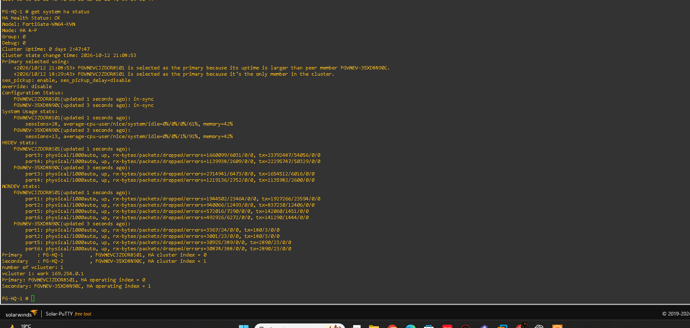
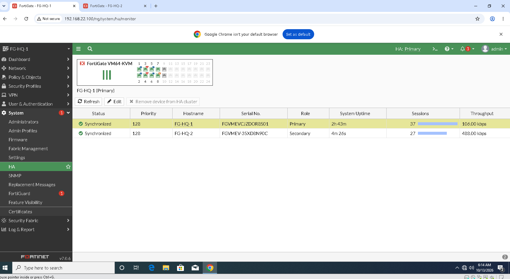
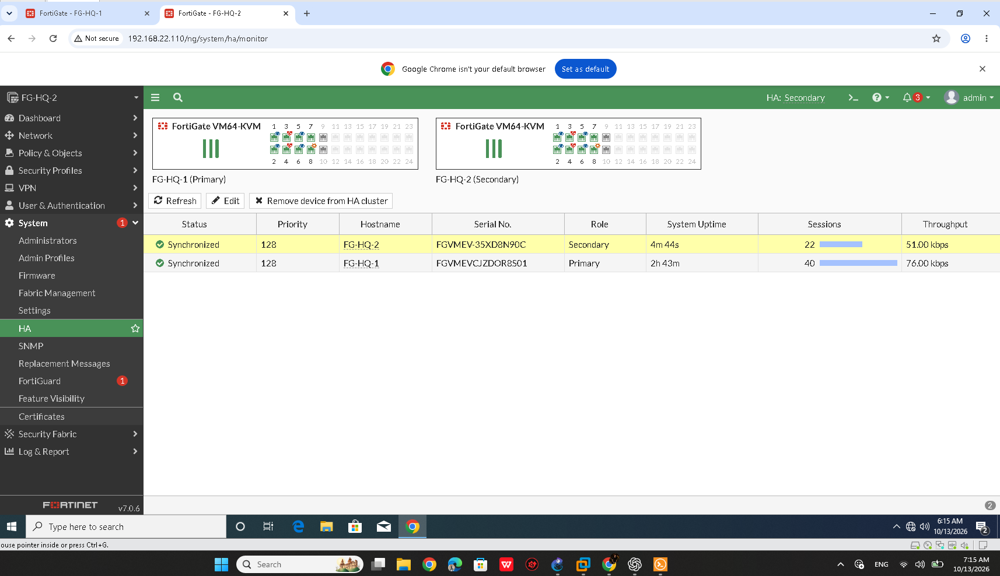
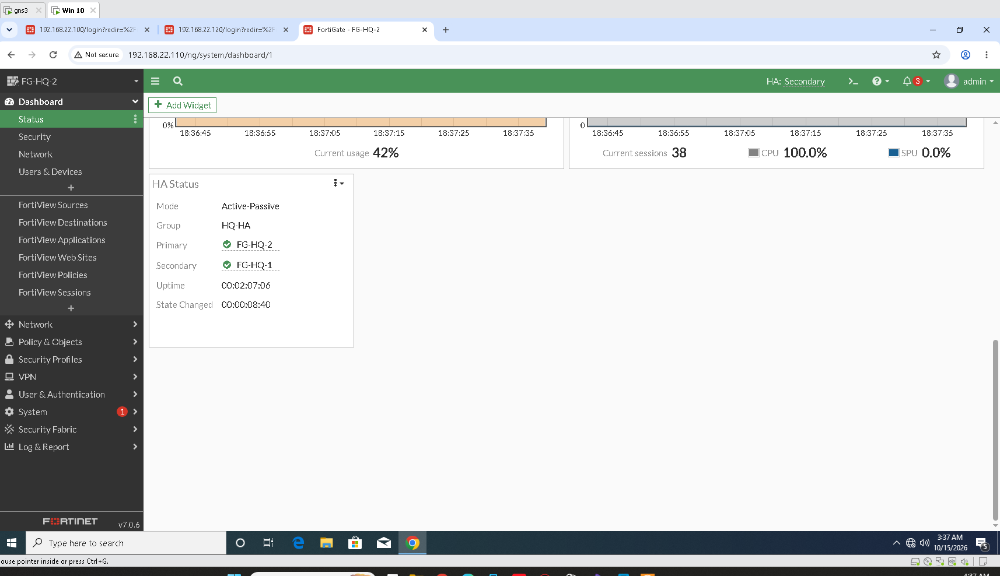
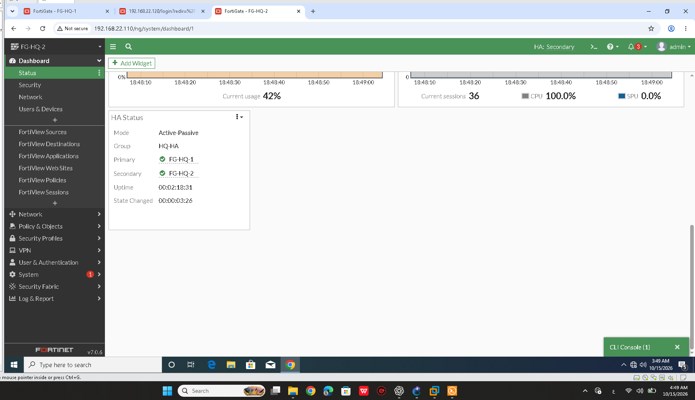

# FortiGate HA Verification

## Overview

The Cairo Headquarters lab uses two FortiGate VM64-KVM appliances configured in Active-Passive (A-P) High Availability mode.

## Cluster Members

| Parameter | FG-HQ-1 | FG-HQ-2 |
|---|---|---|
| Normal HA Role | Primary | Secondary |
| Cluster Index | 0 | 1 |
| Configuration Status | In-sync | In-sync |
| Heartbeat Interfaces | port3, port4 | port3, port4 |
| Monitored Interfaces | port1, port2, port5, port6 | port1, port2, port5, port6 |
| Dedicated Management Interface | port8 | port8 |

## Current Verification Results

The following results were observed during verification:

- HA health status reported `OK`.
- Both cluster members were visible in the HA status output.
- `FG-HQ-1` was observed as Primary and `FG-HQ-2` as Secondary during the normal cluster state.
- Both members reported `in-sync`.
- Heartbeat interfaces `port3` and `port4` were up on both appliances in the collected status output.
- The collected heartbeat interface statistics reported zero RX drops, RX errors, and TX errors at the time of that check.
- Monitored interfaces `port1`, `port2`, `port5`, and `port6` were up in the collected HA status output.

### Normal Cluster State Evidence

## Historical HA Events

The HA history contains previous events in which `FG-HQ-2` lost heartbeat connectivity on `port3` and `port4`. The primary appliance subsequently operated as the only cluster member during some of these events.

The available evidence does not establish the root cause of these historical events.

Although the heartbeat links and their interface counters looked healthy during the recorded checks, this does not prove that the historical interruptions have been permanently resolved.

## Observed Role Change and Recovery

Additional screenshots show a change in HA roles, with `FG-HQ-2` appearing as Primary and `FG-HQ-1` as Secondary. A separate screenshot records HA recovery status.

These screenshots provide evidence of an observed role change and recovery state. They do not, by themselves, establish that a controlled failure of `FG-HQ-1` was performed or that production traffic continued without interruption during the transition.

## Failover Validation

**Status: Partially documented; end-to-end failover validation remains unconfirmed.**

The available evidence supports the following conclusions:

- The cluster was observed in a healthy, synchronized state.
- Both members and their HA roles were visible in the collected status output.
- A change in the displayed Primary/Secondary roles was observed.
- A recovery state was captured.

The available screenshots do not conclusively demonstrate successful traffic continuity during a controlled failover.

To mark operational HA failover as verified, a controlled test must document the initiating failure, the role transition, and successful traffic through `FG-HQ-2` during and after the transition.

## Evidence Files

The following screenshots are referenced in this document:

- `Images/FG-HQ-HA-Status-In-Sync.png`
- `Images/FG-HQ-HA-Status-Primary.png`
- `Images/FG-HQ-HA-Status-Secondary.png`
- `Images/FG-HQ-HA-Failover-to-HQ-2.png`
- `Images/FG-HQ-HA-Recovery.png`

Ensure these filenames match the actual files committed to the repository.

## Conclusion

The FortiGate Active-Passive cluster was observed in a healthy, synchronized state, with both heartbeat interfaces up during the recorded checks. Additional screenshots show an HA role change and recovery state.

Historical heartbeat interruptions remain unexplained. Successful traffic continuity during a controlled HA failover has not yet been conclusively verified, so operational failover should not be marked as fully validated.
