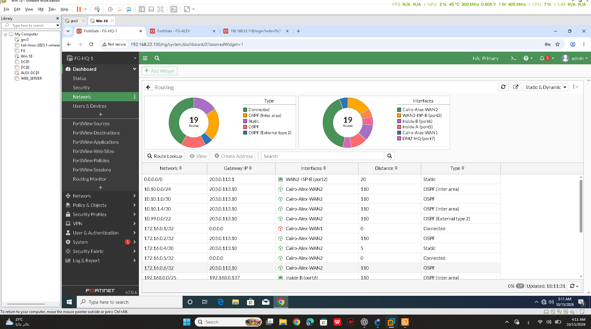
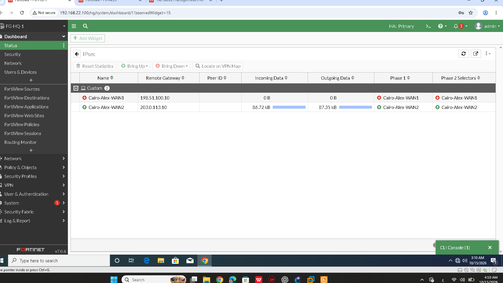
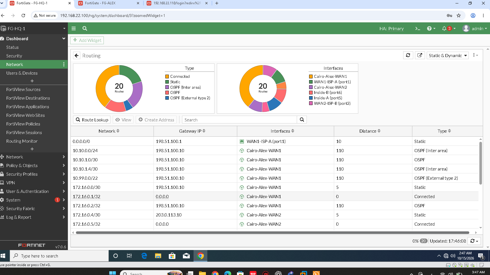
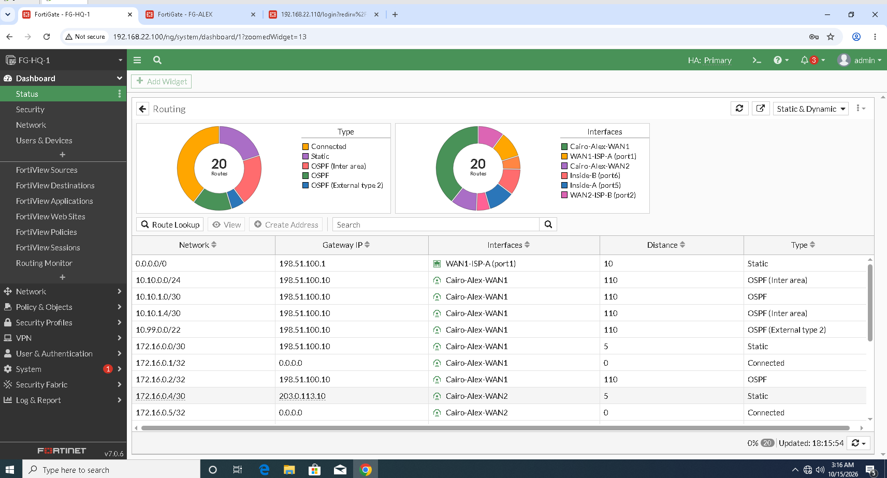

# IPsec VPN Failover and Recovery Verification

## 1. Overview

This document records the IPsec VPN routing and failover tests performed in the Enterprise Multi-Site Network & Security Infrastructure Lab connecting Cairo Headquarters and the Alexandria branch.

The lab uses two WAN paths to provide alternative connectivity between the sites:

- **WAN1:** Primary path under normal operating conditions.
- **WAN2:** Backup path used during the recorded failover test.

The verification covers tunnel status, route selection, failover to WAN2, and recovery to WAN1.

This document distinguishes between tunnel status, routing-table evidence, and end-to-end connectivity tests. A tunnel being up does not independently prove that all application traffic can pass through it.

## 2. VPN Topology and Addressing

The recorded lab uses the following WAN addressing:

| Parameter | Cairo WAN1 | Cairo WAN2 |
|---|---|---|
| FortiGate interface | `port1` | `port2` |
| FortiGate IP | `198.51.100.2/29` | `203.0.113.2/29` |
| ISP gateway | `198.51.100.1` | `203.0.113.1` |
| Associated tunnel | `Cairo-Alex-WAN1` | `Cairo-Alex-WAN2` |

The captured routing tables show the following tunnel next hops:

| VPN Path | Tunnel Next Hop |
|---|---|
| `Cairo-Alex-WAN1` | `198.51.100.10` |
| `Cairo-Alex-WAN2` | `203.0.113.10` |

These values describe the recorded lab topology. They are not a substitute for the complete IPsec Phase 1 and Phase 2 configuration.

## 3. Normal Operation — WAN1 Preferred

The normal-operation evidence shows the WAN1-associated VPN path selected for the recorded remote routes.

The FortiGate routing table showed the default route through WAN1:

```text
S* 0.0.0.0/0 [10/0] via 198.51.100.1, port1
```

The captured routing table associated the following remote networks with `Cairo-Alex-WAN1`:

| Destination | Route Type | Tunnel Next Hop |
|---|---|---|
| `10.10.0.0/24` | OSPF Inter-Area | `198.51.100.10` |
| `10.10.1.0/30` | OSPF | `198.51.100.10` |
| `10.10.1.4/30` | OSPF Inter-Area | `198.51.100.10` |
| `10.99.0.0/22` | OSPF External Type 2 | `198.51.100.10` |

**Result: PASS — The recorded routing table showed the WAN1-associated VPN path selected for the listed remote networks.**

The route entries establish the selected routing path at the time of capture. They do not independently prove that every remote host or application was reachable.

## 4. VPN Tunnel Status Before Failover

The project contains screenshots of the IPsec tunnel status on both the Cairo and Alexandria FortiGate appliances.

**Evidence — Cairo IPsec tunnels**


**Evidence — Alexandria IPsec tunnels**


These screenshots document the displayed tunnel state at the time they were captured. Tunnel status must be considered together with routing and connectivity evidence when evaluating the complete site-to-site path.

## 5. Failover from WAN1 to WAN2

The recorded VPN failover evidence shows the WAN2-associated tunnel path selected after the primary WAN1 path became unavailable.

The captured FortiGate routing table showed the default route through WAN2:

```text
S* 0.0.0.0/0 [20/0] via 203.0.113.1, port2
```

The routing table also showed the listed remote networks associated with `Cairo-Alex-WAN2`:

| Destination | Route Type | Tunnel Next Hop |
|---|---|---|
| `10.10.0.0/24` | OSPF Inter-Area | `203.0.113.10` |
| `10.10.1.0/30` | OSPF | `203.0.113.10` |
| `10.10.1.4/30` | OSPF Inter-Area | `203.0.113.10` |
| `10.99.0.0/22` | OSPF External Type 2 | `203.0.113.10` |

**Result: PASS — The recorded routing evidence showed the remote routes using the WAN2-associated VPN path during failover.**

### 5.1 Failover Evidence







The screenshots provide evidence of the displayed tunnel and routing states. They do not independently establish that all application sessions continued without interruption.

## 6. Recovery to WAN1

The project contains separate evidence showing the routing path returning to WAN1 after recovery.



The routing evidence for the recovered state is consistent with the WAN1 default route:

```text
S* 0.0.0.0/0 [10/0] via 198.51.100.1, port1
```

**Result: PASS — The recorded recovery evidence showed the route returning to the preferred WAN1 path.**

This result confirms the recorded routing recovery. It does not establish zero packet loss or uninterrupted application sessions during the transition.

## 7. Routing and Tunnel State Evidence

The available screenshots document multiple stages of the VPN path:

| Evidence File | Purpose |
|---|---|
| `Images/VPN-Tunnels-Before-Failover.png` | Tunnel state before failover |
| `Images/VPN-Routing-Before-Failover.png` | Routing state before failover |
| `Images/VPN-Failover-to-WAN2.png` | Recorded failover state |
| `Images/VPN-WAN1-Down-WAN2-Up.png` | WAN1/WAN2 tunnel-path state during failover |
| `Images/VPN-Failover-WAN1-Down-WAN2-Up.png` | Additional failover evidence |
| `Images/VPN-Recovery-to-WAN1.png` | Recorded recovery state |
| `Images/VPN-Routing-WAN1-Primary.png` | WAN1-primary routing state |

These images should be interpreted according to the state they display. Similar filenames do not automatically mean that the screenshots are duplicates; compare their contents before removing any evidence from the repository.

## 8. Verification Scope and Limitations

The recorded evidence supports these conclusions:

- The lab has two configured WAN-associated VPN paths.
- The captured normal routing state showed the WAN1-associated path selected for the listed remote networks.
- The captured failover state showed the remote routes using the WAN2-associated path.
- The recorded recovery evidence showed the preferred route returning to WAN1.
- Separate screenshots document the displayed IPsec tunnel states on both FortiGate appliances.

The available evidence does not independently prove:

- Zero packet loss during VPN failover or recovery.
- Uninterrupted application sessions during a path transition.
- Successful access to every remote network and application through both tunnels.
- The complete correctness of every IPsec Phase 1 and Phase 2 setting.
- Successful external HTTPS publishing to the DMZ through both WAN VIPs.

External HTTPS publishing is documented separately in [FortiGate Firewall Policies and Connectivity Verification](../Documentation/fortigate-firewall-policies.md).

Dual-WAN default-route failover and recovery are documented in [Dual-WAN Failover and Recovery Verification](dual-wan-verification.md).

## 9. Overall Result

**PASS — VPN routing failover and recovery were demonstrated in the recorded lab evidence.**

The captured routing states show the remote networks using the WAN1-associated VPN path under the recorded normal condition, switching to the WAN2-associated path during failover, and returning to WAN1 during recovery.

These results support the intended redundant VPN routing design. They do not claim that application sessions remained uninterrupted throughout the transitions or that every application was tested through both paths.

The evidence should remain associated with the specific state shown in each screenshot. Any additional claim about application-level continuity requires a corresponding connectivity test.

## 10. Conclusion

The Enterprise Multi-Site Network & Security Infrastructure Lab demonstrates two WAN-associated VPN routing paths between Cairo HQ and Alexandria.

The recorded routing evidence supports failover to WAN2 and recovery to the preferred WAN1 path. Tunnel-state screenshots provide supporting evidence for the displayed VPN states.

Operational validation of uninterrupted traffic, packet-loss measurements during the transitions, and application-level testing through both VPN paths should be reported only when supported by dedicated test results.

The separate external HTTPS publishing issue involving the WAN2 VIP remains unresolved and is not considered fixed by the VPN failover results.
